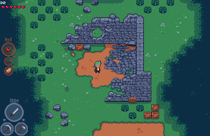

# Sprint 0 - Item Switch Mechanic

## Overview
Users should only be able to use one item at a time. Items can include:
- Seed (to plant)
- Plant (to eat)
- sword (melee weapon) (to swing)
- bow (to shoot)
- picked up item (to throw)

Users will be able to use the up and down buttons to switch between items. Only the active item will have it's action triggered.

## UI - Design
